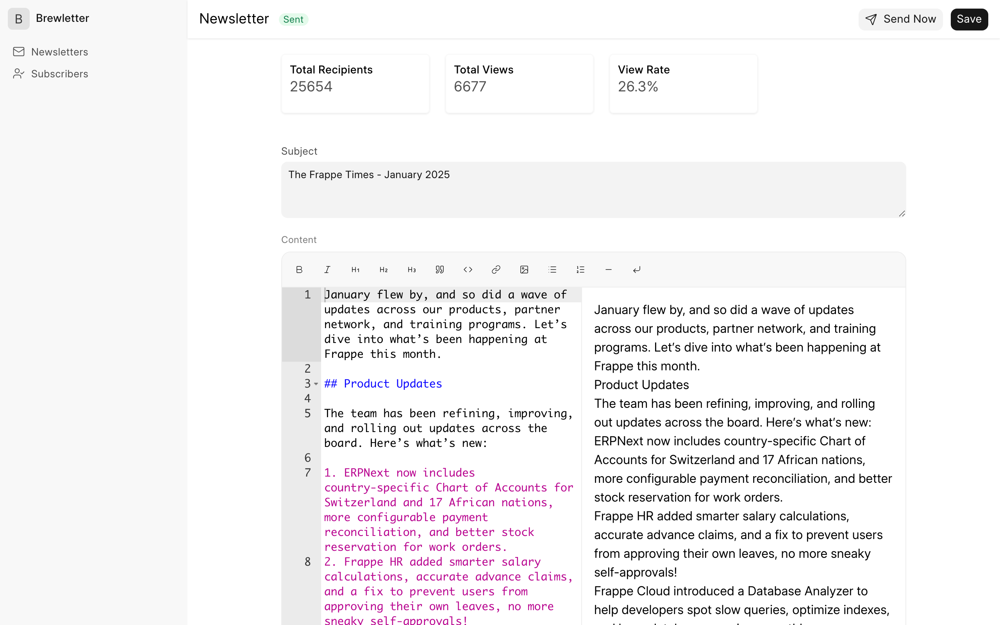
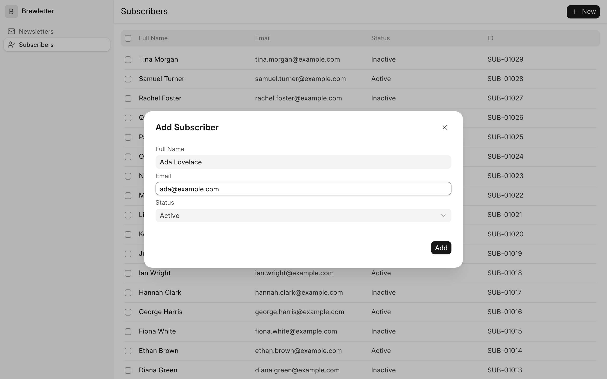
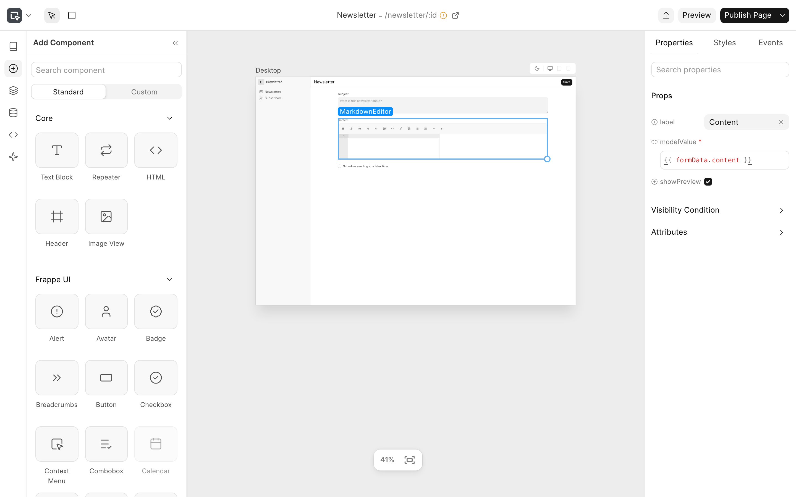

# Brewletter

A newsletter manager built with [Frappe Studio](https://github.com/frappe/studio).

You can write newsletters in Markdown, send them to your active subscribers, and manage the subscriber list.





## Pages

| Page | Route | What it does |
|---|---|---|
| Newsletters | `/brewletter` | Lists newsletters, newest first. Click a row to open it, or **New** to write one. |
| Newsletter | `/brewletter/newsletter/:id` | Edits the subject, content and schedule. Shows the status, recipients, views and view rate. **Send Now** sends it. |
| Subscribers | `/brewletter/subscribers` | Lists subscribers, newest first. **New** adds a subscriber. |

## Built with Frappe Studio

The pages are built in the Studio editor. They are exported to [`studio/brewletter`](studio/brewletter) as JSON, so you can open and change them in Studio.



The app has these parts:

- **Doctypes:** `SD Newsletter` and `Subscriber`. `SD Newsletter.send_newsletter` emails the newsletter to every active subscriber and sets its status to Sent.
- **Pages:** [`studio/brewletter/studio_page`](studio/brewletter/studio_page). The Newsletter page has a page script, [`newsletter.ts`](studio/brewletter/studio_page/newsletter/newsletter.ts), that loads the newsletter into the form and saves or sends it.
- **Custom Vue component:** [`MarkdownEditor`](studio/brewletter/components/MarkdownEditor.vue), a Markdown editor with a toolbar and a live preview. It uses `ace-builds` and `marked` from this app's `package.json`.

## Installation

This app needs [Frappe Studio](https://github.com/frappe/studio). `bench get-app` installs it for you because it is listed in `required_apps`.

```bash
cd $PATH_TO_YOUR_BENCH
bench get-app https://github.com/ruchamahabal/brewletter --branch develop
bench --site $SITE install-app brewletter
bench build --app brewletter
```

`bench build --app brewletter` also builds the Brewletter bundle. Then open `http://$SITE/brewletter`.

**Send Now** queues an email for each active subscriber. Set up an outgoing Email Account on the site before you send.

## Contributing

This app uses `pre-commit` for code formatting and linting. [Install pre-commit](https://pre-commit.com/#installation) and enable it for this repository:

```bash
cd apps/brewletter
pre-commit install
```

Pre-commit runs ruff, eslint, prettier and pyupgrade.

## License

MIT
